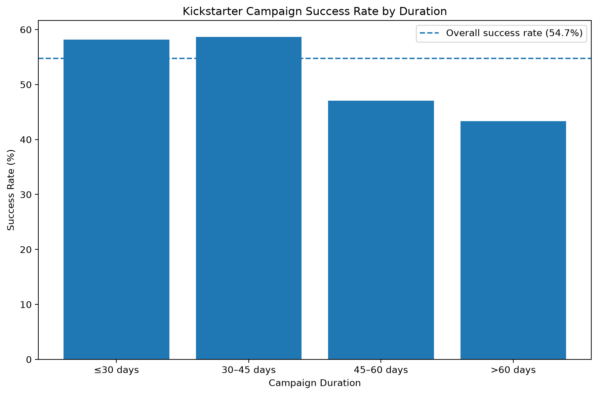
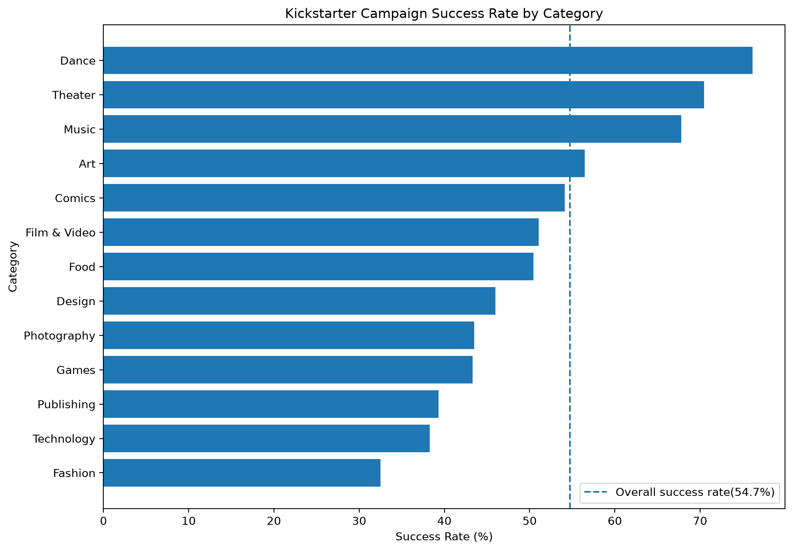

# Kickstarter Crowdfunding Recommendation Engine - Global Financial Firm

A Fall 2026 Break Through Tech AI Studio challenge project developed for a global financial firm. Our team predicts whether a Kickstarter campaign will succeed or fail based on campaign characteristics, explains the factors driving those predictions, and prototypes recommendations for campaigns that appear at risk.

### 👥 **Team Members**
| Name             | GitHub Handle | Contribution                                                                                                                                                                  |
|------------------|---------------|-------------------------------------------------------------------------------------------------------------------------------------------------------------------------------|
| Abigail Galung   | @bazzazy14    | Handle missing values; campaign duration and category/subcategory EDA; model preparation and preprocessing; Logistic Regression baseline; feature-selection experiments                                                                       |
| Ryan Amador      | @RyOnFire     | Acquire, load and filter the dataset; goal and engagement EDA; XGBoost and LightGBM models; final model comparison and selection; recommendation prototype; dependencies        |
| Zainab Akhtar    | @Zainu04      | Prepare U.S.-based campaign records; KNN model; model performance comparison                                                                                                   |
| Nanshu Singla    | @Nanshusingla | Encode and prepare categorical variables; correlation and EDA summary; Random Forest model; SHAP interpretability analysis                                                    |

---

## 🎯 **Project Highlights**

- Built a reproducible data pipeline that turns the raw Kickstarter data into **38,504 U.S. campaigns** with a clear successful/failed outcome, and documented every filtering and cleaning decision.
- Compared **five classification models** (Logistic Regression, Random Forest, KNN, XGBoost, LightGBM) on one shared train/test split, using accuracy, precision, recall, F1, ROC-AUC and confusion matrices.
- Selected **tuned XGBoost** as the final model: **81.4% accuracy and 0.898 ROC-AUC** with the `updates` feature, meeting the project's roughly 80% accuracy target. Without `updates`, the same model reaches 70.3% accuracy and 0.767 ROC-AUC.
- Found that the `updates` feature adds about 11 accuracy points to every model, and documented why it must be interpreted carefully (it may partly be a result of a campaign doing well).
- Used **SHAP** to explain model predictions, and built a **recommendation prototype** that suggests changes to funding goal, campaign length and reward levels for campaigns predicted to fail.

---

## 👩🏽‍💻 **Setup and Installation**

Follow the steps below to set up the project locally and run the notebooks. **Python 3.12 or newer is required** (XGBoost 3.4.1).

### 1. Clone the Repository

```bash
git clone https://github.com/Break-Through-Tech/Global-Financial-Firm-1A-kickstarter-crowdfunding-recommendation-engine.git
cd Global-Financial-Firm-1A-kickstarter-crowdfunding-recommendation-engine
```

### 2. Set Up a Python Virtual Environment
#### macOS / Linux

```bash
python3 -m venv venv
source venv/bin/activate
```

#### Windows PowerShell

```powershell
py -m venv venv
.\venv\Scripts\Activate.ps1
```

#### Windows Command Prompt

```cmd
py -m venv venv
venv\Scripts\activate.bat
```

After activation, you should see `(venv)` at the beginning of your terminal prompt.

### 3. Install Dependencies

```bash
python -m pip install -r requirements.txt
```

The versions in `requirements.txt` are the ones used to produce the reported results.

### 4. Get the Raw Dataset

This project uses the Kickstarter Projects dataset from Kaggle.

1. Download the dataset from Kaggle.
2. Extract the ZIP file.
3. Place the CSV in the `data/` directory and name it `DSI_kickstarterscrape_dataset.csv`.

```text
data/
└── DSI_kickstarterscrape_dataset.csv
```
### 4A. Sample Dataset

A sample dataset containing 500 processed U.S.-based Kickstarter campaign records is included in the [`sample_data/`](sample_data/) directory.

The sample contains both successful and failed campaigns and retains the 17 columns used in the processed dataset. It allows users to explore the dataset structure, inspect campaign characteristics, and test data-loading workflows without downloading the full dataset.

**Dataset:** [`kickstarter_sample.csv`](sample_data/kickstarter_sample.csv)

#### Loading the Sample Dataset

You can load the sample dataset using pandas:

```python
import pandas as pd

# Load the sample dataset
df = pd.read_csv("sample_data/kickstarter_sample.csv")

# Preview the first five records
print(df.head())

# Check the dataset dimensions
print(df.shape)

# View the distribution of campaign outcomes
print(df["status"].value_counts())
```

The `data/` folder is excluded from version control, so each team member keeps their own copy.

### 5. Build the Modeling Dataset

The model notebooks read `data/kickstarter_us_filtered.csv`, which is produced in three steps. Run them in this order:

| Step | What it does | How to run | Output |
|------|--------------|------------|--------|
| 1 | Keeps only successful and failed campaigns | `python scripts/filter_campaigns.py` (from the repo root) | `data/kickstarter_filtered.csv` |
| 2 | Handles missing values | Run `notebooks/03_handle_missing_values.ipynb` | `data/kickstarter_missing_values_handled.csv` |
| 3 | Keeps U.S.-based campaigns | Run `notebooks/task_4_us_campaign_records.ipynb` | `data/kickstarter_us_filtered.csv` |

### 6. Run the Notebooks
The project notebooks are in the `notebooks/` directory. Run them from that folder, since they read data using the relative path `../data/`.

#### Option 1: Jupyter Notebook

```bash
jupyter notebook
```

Then open the notebook you want to run from the `notebooks/` directory.

#### Option 2: Visual Studio Code

1. Open the repository folder in Visual Studio Code.
2. Install the **Python** and **Jupyter** extensions if needed.
3. Open a `.ipynb` file from `notebooks/`.
4. Select the Python environment you created above as the kernel.
5. Run the cells in order.

### Notebook Guide

| Milestone | Notebooks |
|-----------|-----------|
| 1. Data preparation | `03_handle_missing_values`, `task_4_us_campaign_records`, `05_categorical_variable_preparation` |
| 2. Exploratory analysis | `06_goal_vs_success_analysis`, `milestone2_task2_duration_analysis`, `milestone2_task3_engagement_analysis`, `milestone2_task4_categorical_analysis`, `milestone2_task5_location_analysis`, `milestone2_task6_reward_levels_analysis_completed`, `milestone2_task7_correlation_summary` |
| 3. Machine learning | `milestone3_task1_model_preparation`, `milestone3_feature_selection_experiments`, `milestone3_task2_logistic_regression`, `milestone3_task3_random_forest`, `milestone3_task4_knn_analysis`, `milestone3_task5_xgboost`, `milestone3_task6_model_comparison`, `milestone3_task7_shap_analysis`, `milestone3_task7b_shap_final_xgboost`, `milestone3_task8_final_model_selection` |
| 3. With-`updates` reruns | `milestone3_task3_random_forest_with_updates`, `milestone3_task4_knn_analysis_with_updates`, `milestone3_task5_xgboost_with_updates` |
| 4. Recommendation prototype | `milestone4_recommendation_prototype` |

---

## 🏗️ **Project Overview**

This project is part of the **Break Through Tech AI Studio** program. From August to December 2026, our team is working on a Challenge Project with the goal of predicting whether a Kickstarter campaign will **succeed or fail** and turning those insights into practical guidance for campaign creators. The project ends with a final presentation to stakeholders.

An effective recommendation engine could help creators set more realistic goals, choose a better campaign length, and understand which characteristics are associated with successful campaigns.

More broadly, the project demonstrates how historical data and machine learning can support **financial decision-making under uncertainty**. By estimating the likelihood of campaign success and identifying factors associated with stronger outcomes, the system provides a structured, data-driven way to evaluate decisions involving funding targets, timing, and campaign strategy. This predictive and recommendation-based approach is relevant to a **global financial firm** because it illustrates how data can be transformed into interpretable insights that support more informed financial decisions.

---

## 📊 **Data Exploration**

**Dataset.** The Kickstarter Projects dataset from Kaggle (CSV). After keeping only successful and failed campaigns, removing records with missing values, and keeping U.S.-based campaigns, the modeling dataset has **38,504 campaigns and 18 columns**. About **54.7%** of these campaigns succeeded.

**Preparation.** We filtered to successful and failed outcomes (dropping live, suspended and canceled campaigns), handled missing values, extracted the state from the `location` column, and kept U.S.-based campaigns. Categorical variables (category, subcategory, state) are one-hot encoded.

**Key findings from the exploratory analysis**

- **Goal amount:** Lower goals were associated with higher success. The median goal was USD 3,000 for successful campaigns and USD 5,000 for failed ones. Success rates fell from about 69% (USD 0-1k) to 49% (USD 5k-10k) and 8% (USD 100k-500k).
- **Duration:** Campaigns of 45 days or less succeeded about 58% of the time, versus about 47% for 45-60 days and 43% for longer campaigns.
- **Updates and comments:** Successful campaigns had a median of 5 updates versus 0 for failed campaigns. `updates` had the strongest correlation with success (Pearson 0.39, Spearman 0.55).
- **Reward levels:** Success rose with the number of reward levels, from about 28% for campaigns with 1 level to about 58% for 10 levels.
- **Category and location:** Dance (76%), Theater (70%) and Music (68%) had the highest category success rates; Fashion (33%) had the lowest. Some cities, such as Brooklyn (about 72%), showed higher success rates than others.

### EDA Visualizations

#### Campaign Duration vs. Success Rate

**Key takeaway:** Campaigns lasting 45 days or less had success rates of about 58%, while success declined to about 47% for campaigns lasting 45–60 days and 43% for campaigns longer than 60 days. This suggests that longer campaign durations were associated with lower historical success rates.

#### Campaign Category vs. Success Rate

**Key takeaway:** Success rates varied substantially across campaign categories. Dance (~76%), Theater (~70%), and Music (~68%) had some of the highest success rates, while Fashion was considerably lower at about 33%. This suggests that campaign category contains useful predictive information about historical outcomes.

**Challenges and assumptions**

- **Data leakage.** Columns such as pledged amount, backers, comments and funded percentage are only known after a campaign launches. They were excluded from the models so that predictions reflect information available around launch.
- **The `updates` feature.** `updates` was added on Challenge Advisor guidance and is highly predictive, but the historical data may include updates posted after launch. We therefore report results both with and without it.
- **Associations, not causes.** All findings describe patterns in historical data; they do not show that changing a feature would cause a campaign to succeed.
- **Data quirks.** Some category labels contain HTML entities (for example, `&amp;`), and the goal column contains extreme values.

---

## 🧠 **Model Development**

- **Models:** Logistic Regression (baseline), Random Forest, K-Nearest Neighbors, XGBoost and LightGBM.
- **Target:** successful = 1, failed = 0.
- **Features:** funding goal, campaign duration, number of reward levels, category, subcategory and state, plus `updates` in the primary results.
- **Split:** 80/20 stratified train/test split (`random_state=42`): 30,803 training and 7,701 test campaigns. All models use the same split.
- **Preprocessing:** a scikit-learn `Pipeline` with `StandardScaler` for numeric features and `OneHotEncoder` for categorical features, fit on the training data only to avoid leakage.
- **Tuning:** hyperparameters were selected with 5-fold cross-validated ROC-AUC on the training data only (`GridSearchCV` or randomized search). The test set was used once per final model.
- **Feature experiments:** adding `city` improved accuracy by only about 0.5 points while multiplying the feature count from 119 to about 2,900, so it was not used. Adding `updates` improved accuracy by about 11.6 points.
- **Final model:** XGBoost with `learning_rate=0.1`, `max_depth=3`, `n_estimators=400`.

### Why These Models?
We compared several classification approaches to understand both predictive performance and model tradeoffs:

- **Logistic Regression** was used as an interpretable baseline because it provides a simple reference point for evaluating whether more complex models meaningfully improve performance.
- **Random Forest** was included to capture nonlinear relationships and interactions between campaign features that a linear model may miss.
- **K-Nearest Neighbors (KNN)** provided a distance-based benchmark and allowed us to compare a fundamentally different classification approach using the same processed feature set.
- **XGBoost and LightGBM** were evaluated as gradient-boosted tree models because they are well suited to structured tabular data and can capture complex feature relationships while providing strong predictive performance.
- **SHAP** was used for model interpretability to examine which features contributed most strongly to predictions.

All models were evaluated on the same stratified train/test split and compared using accuracy, precision, recall, F1 score, and ROC-AUC. Hyperparameter tuning was performed on the training data using cross-validation so that the test set could remain an independent evaluation of final model performance.

---
## 💻 Code Highlights

| File / Function | Purpose |
|---|---|
| `scripts/filter_campaigns.py` | Filters the raw Kickstarter dataset to the two target outcomes, **successful** and **failed**, and saves the filtered dataset used in later preprocessing steps. |
| `notebooks/milestone3_task1_model_preparation.ipynb` | Prepares the modeling features and shared train/test split, including numeric scaling and one-hot encoding of categorical variables. |
| `notebooks/milestone3_feature_selection_experiments.ipynb` | Compares alternative feature sets, including experiments with `city` and `updates`, to evaluate predictive improvement against added model complexity. |
| `notebooks/milestone3_task6_model_comparison.ipynb` | Compares the classification models using common evaluation metrics and supports final model selection. |
| `scripts/export_artifacts.py` | Recreates the two final XGBoost pipelines using the same preprocessing and train/test split, then exports the trained models and lookup data used by the Streamlit application. |
| `app/recommender.py` — `recommend_campaign()` | Loads the exported models, predicts campaign success risk, compares campaigns with successful peers, and generates ranked recommendations for controllable features such as goal, duration, and reward levels. |
| `app/streamlit_app.py` | Provides the user-facing interface for entering campaign characteristics and viewing predicted success probabilities, risk levels, peer comparisons, and recommendations. |

The recommendation system intentionally provides two model views: **Plan A without `updates`** and **Plan B with `updates`**, allowing users to compare predictions while acknowledging the potential timing and leakage concerns associated with that feature.

---

## 📈 **Results & Key Findings**

Test-set results for the tuned models, with and without the `updates` feature:

**With `updates` (primary results)**

| Model               | Accuracy | Precision | Recall | F1    | ROC-AUC |
|---------------------|----------|-----------|--------|-------|---------|
| Logistic Regression | 0.803    | 0.820     | 0.819  | 0.819 | 0.880   |
| Random Forest       | 0.815    | 0.818     | 0.851  | 0.834 | 0.892   |
| KNN (K=41)          | 0.765    | 0.776     | 0.803  | 0.789 | 0.841   |
| **XGBoost**         | 0.814    | 0.823     | 0.842  | 0.832 | **0.898** |
| LightGBM            | 0.816    | 0.823     | 0.847  | 0.835 | **0.898** |

**Without `updates` (robustness check)**

| Model               | Accuracy | Precision | Recall | F1    | ROC-AUC |
|---------------------|----------|-----------|--------|-------|---------|
| Logistic Regression | 0.686    | 0.691     | 0.771  | 0.729 | 0.746   |
| Random Forest       | 0.703    | 0.702     | 0.793  | 0.745 | 0.761   |
| KNN (K=41)          | 0.652    | 0.657     | 0.763  | 0.706 | 0.705   |
| **XGBoost**         | 0.703    | 0.702     | 0.795  | 0.746 | **0.767** |
| LightGBM            | 0.702    | 0.702     | 0.792  | 0.744 | 0.765   |

**What the results show**

- **`updates` matters more than the algorithm.** It adds about 11-12 accuracy points to every model. An earlier comparison that gave `updates` only to Logistic Regression made it look best; on equal features, the tree-based models lead.
- **XGBoost, LightGBM and Random Forest are effectively tied** at the top (differences of about 0.001-0.006 ROC-AUC are within noise). XGBoost was selected for the highest or tied-highest ROC-AUC in both settings.
- **Tuning helped only slightly** (about +0.005 ROC-AUC), and a second wider search produced no meaningful improvement, suggesting performance was more constrained by the available features than by further hyperparameter tuning.
- **Failed campaigns are harder to catch.** Even with `updates`, the best models identify about 78% of failed campaigns (about 59% without it).
- **Explainability (SHAP):** `milestone3_task7_shap_analysis` explains Logistic Regression: `updates` had the largest influence, followed by funding goal and campaign duration. `milestone3_task7b_shap_final_xgboost` repeats the analysis on the final tuned XGBoost model, with and without `updates` (the same models used in the Streamlit app). On the XGBoost model the ranking is `updates`, funding goal, then category; without `updates`, funding goal and reward levels lead.
- **Recommendation prototype:** `milestone4_recommendation_prototype` produces two recommendations for a campaign predicted to fail: one from a model without `updates`, and one from a model that uses `updates` as context. Both suggest changes to funding goal, campaign length and reward levels. Updates are deliberately not recommended as something to "do more of," because they are more likely a result of success than a cause.

---

## 🚀 **Next Steps**

**Limitations**

- **Timing of `updates`.** If updates are counted after launch, a creator using the tool before launching would not yet have this number. Results without `updates` (about 70% accuracy) show the cost of leaving it out.
- **Association, not causation.** Recommendations are model estimates based on historical patterns, not guarantees.
- **Single test split.** Differences smaller than about 0.01 ROC-AUC should not be over-interpreted.
- **Failed-campaign detection** is weaker than success detection.

**With more time we would**

- Tune the decision threshold or use class weights to catch more failed campaigns.
- Extend the final-model SHAP analysis (`milestone3_task7b_shap_final_xgboost`) with repeated cross-validation to check the ranking is stable.
- Use repeated cross-validation for a finer model ranking.
- Further develop and deploy the Streamlit application for broader user testing.
- Explore additional features, such as campaign text.

---

## 📝 **License**

This project is licensed under the [MIT License](LICENSE).

---

## 📄 **References**

- [Kickstarter Projects dataset on Kaggle](https://www.kaggle.com/parienza/kickstarter)
- [scikit-learn documentation](https://scikit-learn.org/stable/)
- [XGBoost documentation](https://xgboost.readthedocs.io/)
- [LightGBM documentation](https://lightgbm.readthedocs.io/)
- [SHAP documentation](https://shap.readthedocs.io/)

---

## 🙏 **Acknowledgements**

Thank you to our Challenge Advisor, Neha Panchal, and our AI Studio Coach, Darshan Ugale, for their guidance throughout the project.
